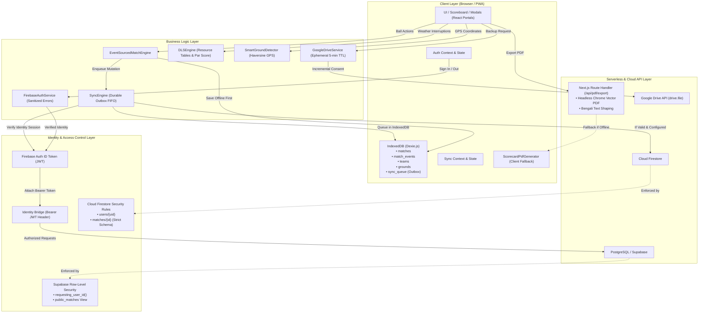
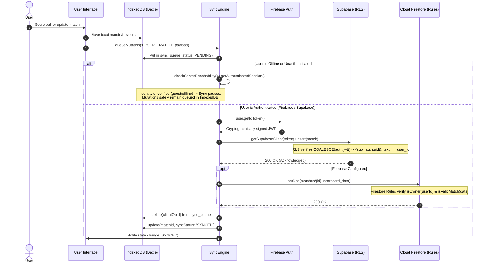

# Cricket Application Architecture & Security Specification

## Overview

This document provides a comprehensive overview of the Cricket Scorer Pro architecture, with specific emphasis on its **Offline-First Synchronization Engine**, **Unified Authentication & Identity Bridging**, and **Multi-Layer Security Model**.

---

## 1. System Architecture

---

## 2. Authentication & Cloud Sync Request Flow

---

## 3. Core Security Pillars

### A. Unified Identity & RLS Bridging
- **No Unverified Assumptions**: `SyncEngine` never assumes a Firebase UID is equivalent to Supabase `auth.uid()` without cryptographic verification.
- **Token Passing**: Signed JWT ID tokens (`auth.currentUser.getIdToken()`) are transmitted via the `Authorization: Bearer <token>` header to Supabase REST endpoints.
- **Supabase RLS Function**: The PostgreSQL helper `public.requesting_user_id()` evaluates `COALESCE(auth.jwt() ->> 'sub', auth.uid()::text)`. If unauthenticated, it returns `NULL`, rejecting write attempts and preventing client spoofing.
- **Offline Preservation**: If identity is unverified, synchronization is halted. Mutations remain securely queued in IndexedDB (`db.sync_queue`) until authentication is established.

### B. Firestore Match Security Rules (`firestore.rules`)
- **Strict Schema Validation (`isValidMatch`)**: Enforces required field existence (`id`, `userId`, `teamA`, `teamB`, `totalOvers`, `status`, `currentInnings`, `isPublic`, `createdAt`, `updatedAt`) and an exact key whitelist.
- **Type & Size Bounds**: Validates types, string lengths (teams <= 100, venue <= 200, result <= 500), integer bounds (totalOvers 1-100, currentInnings 1-4, targetScore 0-5000), and caps scorecard payloads (<= 1MB).
- **Immutable Attributes**: `userId` (ownership), `id`, and `createdAt` are immutable on updates. Ownership cannot be transferred.
- **Isolated Deletes**: Only the document owner can delete matches.
- **Public Spectator Access**: Read access allows `resource.data.isPublic == true` for spectators or `request.auth.uid == resource.data.userId` for private matches.

### C. Supabase Spectator Privacy & Public View
- **Dedicated View (`public_matches`)**: Spectators and broadcast widgets read from `public.public_matches`, which exposes match details and scorecard data while omitting the owner's private `user_id`.
- **All Tables Protected**: Row-Level Security is strictly enabled on `matches`, `teams`, `tournaments`, and `grounds`.

### D. Authentication Error Sanitization & Email Enumeration Mitigation
- **Anti-Enumeration Login**: `auth/user-not-found`, `auth/wrong-password`, `auth/invalid-credential`, and `auth/invalid-login-credentials` return identical user messages: `"Invalid email or password. Please verify your credentials and try again."`
- **Anti-Enumeration Password Reset**: `sendPasswordReset` returns generic success if an email is not found, preventing attackers from probing registered email addresses.
- **Redacted Errors**: Unknown SDK errors return a generic message (`"An unexpected authentication error occurred. Please try again later."`) and never expose internal URLs, network diagnostics, or credentials.
- **Log Sanitation**: Sensitive parameters (passwords, tokens, API keys) are strictly excluded from console logs.

### E. Google Drive Token Lifecycle & Boundaries
- **Ephemeral TTL**: Access tokens are held in-memory with a strict 5-minute maximum lifetime (`MAX_EPHEMERAL_TTL_MS`), after which they are purged.
- **Automatic Purging**: Tokens are cleared on expiry, upon receiving an HTTP 401 response, on user sign-out (`FirebaseAuthService.signOutUser`), or via explicit revocation (`GoogleDriveService.revokeAccessToken`).
- **Token Separation**: `GoogleDriveAuthSpec.assertTokenSeparation` verifies token format and explicitly rejects Firebase Auth ID tokens / JWTs, preventing cross-token confusion.
- **Least Privilege**: Restricted to `https://www.googleapis.com/auth/drive.file`.

---

## 4. Centralized PDF Generation Subsystem & Bengali Typography

### A. Dual-Engine Generation Pipeline
1. **Primary Path (Server-Side Vector Engine)**:
   - Client sends match scorecard payload to `/api/pdf/export`.
   - The route handler uses headless Chrome / Puppeteer with print CSS emulation to render a multi-page, vector-sharp A4 PDF.
   - Bengali font glyphs (`SolaimanLipi`, `Noto Sans Bengali`) are shaped server-side using native HarfBuzz / FreeType shaping engines in Chromium, guaranteeing 100% correct conjunct representation (e.g. `ক্ষ`, `জ্ঞ`, `্র`).
2. **Resilient Fallback (Client-Side jsPDF Engine)**:
   - If offline or if the export endpoint is unreachable, `ScorecardPdfGenerator` seamlessly transitions to client-side vector compilation using `jspdf` and `jspdf-autotable`.
   - Generates standard ASCII/English A4 scorecards instantly in browser memory without throwing network errors.

### B. Progress State Machine
The generation lifecycle emits structured stage updates through `PdfLoadingContext`:
$$\text{IDLE} \longrightarrow \text{INITIALIZING} \longrightarrow \text{PREPARING\_DATA} \longrightarrow \text{RENDERING\_VECTOR} \longrightarrow \text{PACKAGING} \longrightarrow \text{READY}$$
UI overlays display real-time feedback with stage indicators, animated micro-bars, and multi-action delivery options (Direct Download, Print, Web Share API, Clipboard, Google Drive).

---

## 5. Duckworth-Lewis-Stern (DLS) Weather Interruption Subsystem

### A. Mathematical Model & Resource Tables
For rain-delayed or interrupted matches, Cric Scorer Pro applies the standard DLS mathematical resource formula:
$$R(u, w) = R_0(w) \times \left(1 - e^{-b(w) \times u}\right)$$
Where:
- $u$ = Overs remaining (0 to 50).
- $w$ = Wickets lost (0 to 9).
- $R_0(w)$ = Maximum resource percentage with $w$ wickets lost.
- $b(w)$ = Decay parameter calibrated for modern limited-overs scoring.

### B. Target Revision Logic
- **When Team 2's resources are reduced ($R_2 < R_1$)**:
  $$\text{Target} = \left\lfloor S \times \frac{R_2}{R_1} \right\rfloor + 1$$
- **When Team 2's resources exceed Team 1 ($R_2 > R_1$)**:
  $$\text{Target} = S + \left\lfloor \frac{R_2 - R_1}{100} \times G_{50} \right\rfloor + 1$$
  *(where $G_{50}$ is the average 50-over total benchmark for the competition tier, default = 245).*

---

## 6. Smart Cricket Grounds & Geolocation Subsystem

### A. Spherical Distance Calculation
Venues are matched against the user's current GPS coordinates using the Haversine formula:
$$a = \sin^2\left(\frac{\Delta \phi}{2}\right) + \cos(\phi_1) \cdot \cos(\phi_2) \cdot \sin^2\left(\frac{\Delta \lambda}{2}\right)$$
$$d = 2 \cdot R \cdot \text{atan2}\left(\sqrt{a}, \sqrt{1 - a}\right)$$
- If distance $d \le 1.5\text{ km}$, `SmartGroundDetector` automatically suggests the detected ground with high confidence.
- Results are cached in IndexedDB `grounds` table with full offline support.

---

## 7. Context7 MCP Live Architecture Maintenance

To prevent documentation decay and architectural misalignment:
1. **Live Framework Guidance**: Developers and automated agents use the Context7 MCP server (`resolve-library-id`, `query-docs`) to query official documentation and latest API standards before implementing architectural changes.
2. **Version Pinning**: Documentation queries target specific versions matching `package.json` (`Next.js 14.2`, `React 18.3`, `Tailwind 3.4`, `Dexie 4.0`, `Vitest 3.0`).
3. **Continuous Verification**: Architectural models are verified against the 1,044 Vitest tests across 90 test suites before each production release.
