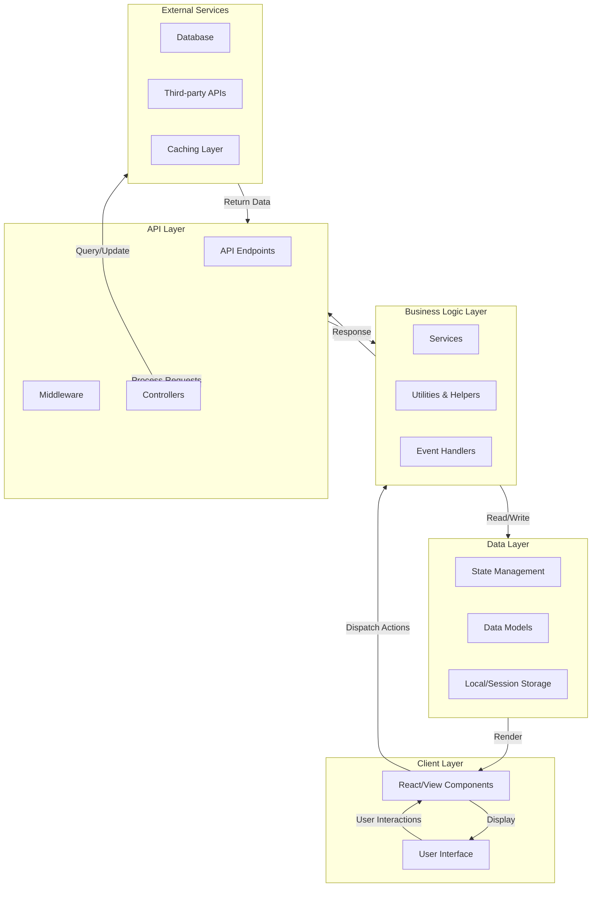

# Cricket Application Architecture

## Overview

This document provides a high-level overview of the Cricket application architecture. The application is primarily built with TypeScript (96.8%), with small portions of JavaScript (1.7%) and other languages (1.5%).

## Architecture Diagram

## Layer Descriptions

### Client Layer
- **User Interface**: The visual presentation layer where users interact with the application
- **React/View Components**: Reusable UI components built with TypeScript

### Business Logic Layer
- **Services**: Core business logic and application rules
- **Utilities & Helpers**: Common utility functions and helper methods
- **Event Handlers**: User interaction handlers and event processing

### Data Layer
- **State Management**: Application state management (Redux, Context API, etc.)
- **Data Models**: TypeScript interfaces and types defining data structures
- **Local/Session Storage**: Client-side data persistence

### API Layer
- **API Endpoints**: RESTful or GraphQL endpoints
- **Middleware**: Request/response processing middleware
- **Controllers**: Request handlers and response formatters

### External Services
- **Database**: Persistent data storage
- **Third-party APIs**: External service integrations
- **Caching Layer**: Performance optimization through caching

## Technology Stack

- **Primary Language**: TypeScript (96.8%)
- **Secondary Language**: JavaScript (1.7%)
- **Other**: 1.5%

## Key Principles

1. **Separation of Concerns**: Each layer has distinct responsibilities
2. **Type Safety**: Heavy use of TypeScript for compile-time type checking
3. **Modularity**: Components and services are designed to be reusable
4. **Scalability**: Architecture supports growth and feature expansion

---

*This architecture serves as a foundation for the Cricket application's design and can be expanded based on specific implementation details.*
