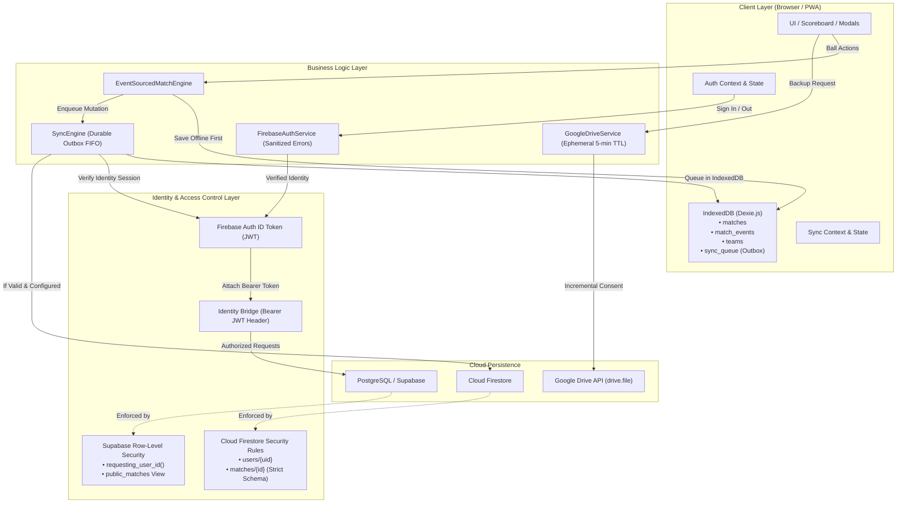
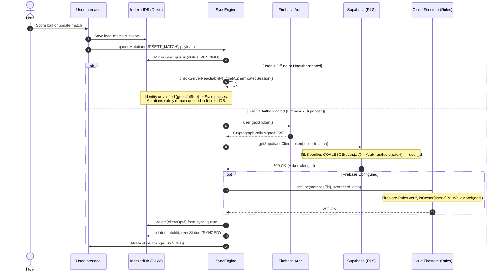

# Cricket Application Architecture & Security Specification

## Overview

This document provides a comprehensive overview of the Cricket Scorer Pro architecture, with specific emphasis on its **Offline-First Synchronization Engine**, **Unified Authentication & Identity Bridging**, and **Multi-Layer Security Model**.

---

## 1. System Architecture

---

## 2. Authentication & Cloud Sync Request Flow

---

## 3. Core Security Pillars

### A. Unified Identity & RLS Bridging
- **No Unverified Assumptions**: `SyncEngine` never assumes a Firebase UID is equivalent to Supabase `auth.uid()` without cryptographic verification.
- **Token Passing**: Signed JWT ID tokens (`auth.currentUser.getIdToken()`) are transmitted via the `Authorization: Bearer <token>` header to Supabase REST endpoints.
- **Supabase RLS Function**: The PostgreSQL helper `public.requesting_user_id()` evaluates `COALESCE(auth.jwt() ->> 'sub', auth.uid()::text)`. If unauthenticated, it returns `NULL`, rejecting write attempts and preventing client spoofing.
- **Offline Preservation**: If identity is unverified, synchronization is halted. Mutations remain securely queued in IndexedDB (`db.sync_queue`) until authentication is established.

### B. Firestore Match Security Rules (`firestore.rules`)
- **Strict Schema Validation (`isValidMatch`)**: Enforces required field existence (`id`, `userId`, `teamA`, `teamB`, `totalOvers`, `status`, `currentInnings`, `isPublic`, `createdAt`, `updatedAt`) and an exact key whitelist.
- **Type & Size Bounds**: Validates types, string lengths (teams <= 100, venue <= 200, result <= 500), integer bounds (totalOvers 1-100, currentInnings 1-4, targetScore 0-5000), and caps scorecard payloads (<= 1MB).
- **Immutable Attributes**: `userId` (ownership), `id`, and `createdAt` are immutable on updates. Ownership cannot be transferred.
- **Isolated Deletes**: Only the document owner can delete matches.
- **Public Spectator Access**: Read access allows `resource.data.isPublic == true` for spectators or `request.auth.uid == resource.data.userId` for private matches.

### C. Supabase Spectator Privacy & Public View
- **Dedicated View (`public_matches`)**: Spectators and broadcast widgets read from `public.public_matches`, which exposes match details and scorecard data while omitting the owner's private `user_id`.
- **All Tables Protected**: Row-Level Security is strictly enabled on `matches`, `teams`, `tournaments`, and `grounds`.

### D. Authentication Error Sanitization & Email Enumeration Mitigation
- **Anti-Enumeration Login**: `auth/user-not-found`, `auth/wrong-password`, `auth/invalid-credential`, and `auth/invalid-login-credentials` return identical user messages: `"Invalid email or password. Please verify your credentials and try again."`
- **Anti-Enumeration Password Reset**: `sendPasswordReset` returns generic success if an email is not found, preventing attackers from probing registered email addresses.
- **Redacted Errors**: Unknown SDK errors return a generic message (`"An unexpected authentication error occurred. Please try again later."`) and never expose internal URLs, network diagnostics, or credentials.
- **Log Sanitation**: Sensitive parameters (passwords, tokens, API keys) are strictly excluded from console logs.

### E. Google Drive Token Lifecycle & Boundaries
- **Ephemeral TTL**: Access tokens are held in-memory with a strict 5-minute maximum lifetime (`MAX_EPHEMERAL_TTL_MS`), after which they are purged.
- **Automatic Purging**: Tokens are cleared on expiry, upon receiving an HTTP 401 response, on user sign-out (`FirebaseAuthService.signOutUser`), or via explicit revocation (`GoogleDriveService.revokeAccessToken`).
- **Token Separation**: `GoogleDriveAuthSpec.assertTokenSeparation` verifies token format and explicitly rejects Firebase Auth ID tokens / JWTs, preventing cross-token confusion.
- **Least Privilege**: Restricted to `https://www.googleapis.com/auth/drive.file`.
